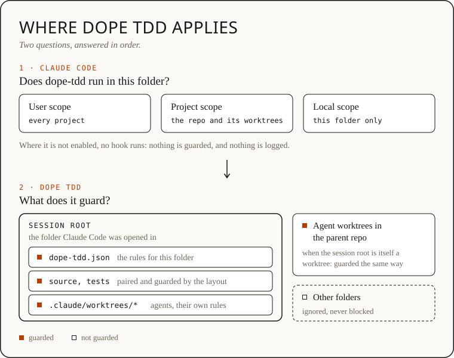

# Dope TDD

**D.O.P.E.** Deny, Observe, Prove, Evidence.
*Don't overdub, prove every bar.*

Dope TDD keeps Claude Code test-first. It refuses an edit to source code until
that code's test has been written or seen failing, reads your test runner's
results, and proves each passing test catches the change by undoing the change
and running the test again. Other tools judge whether the agent followed TDD;
Dope TDD proves the test catches the change, by running it, with no judge
model reading each edit.

In the studio, an overdub covers a bad take instead of recording it again.
Bending a test until it passes is the overdub, and Dope TDD hears it.

It is a Claude Code plugin (a *mod*: it runs inside Claude Code). It checks
every Edit, Write, NotebookEdit and shell command before it runs. A rule in
CLAUDE.md is advice Claude can forget; this is a gate it has to pass, and
every refusal says why and what to do instead.

## What you see

Claude tries to fix a bug before writing a test:

```
dope-tdd: write the failing test first. Touch tests/text/slugify.test.ts, or run it and see it fail, before editing src/text/slugify.
Unblock by one of:
(1) write or edit tests/text/slugify.test.ts so it fails, then run it: npx vitest run tests/text/slugify.test.ts
(2) no test for this code yet: /dope-tdd:pin pins what it does now
(3) neither fits: ask for an override with mcp__dope-tdd__override_request; a person decides, and it is recorded
```

Claude writes the test, sees it fail, fixes the code, and sees it pass. Dope
TDD undoes the fix in a throwaway copy, runs the test again, sees it fail, and
says so. The band above the prompt shows where things stand:

```
☠ dope-tdd   fileGate   red ✓   green ✓   PROVEN      last run: fileGate.test.ts passed · just now
  next  refactor while the test guards it, then commit                        [VIEW TEST]
```

## Install

```bash
claude plugin marketplace add andres-fu/dope-tdd
claude plugin install dope-tdd@dope-tdd --scope project
```

Run it inside the repository you want guarded. `--scope project` turns Dope
TDD on for that project only, in `.claude/settings.json`, which you commit so
your team gets the same guard. `--scope local` keeps it to yourself; the
default, `--scope user`, turns it on in every project on this machine.

Needs Claude Code v2.1.287 or later (the Desktop app's Code tab: v2.1.286 or
later). An older version skips the plugin without saying so: check
`claude --version`, then run `/tdd` in a session. It should say `guard: ON`.
The band draws in the terminal and the Desktop app's Code tab; in the VS Code
chat panel, read the tool results and `/tdd` instead.

**Refusing edits is the point.** To ease off, set `"mode": "warn"` (allow and
count) or `"observe"` (count only) in `dope-tdd.json` at the repo root. To turn
it off: `claude plugin disable dope-tdd@dope-tdd` (add `--scope project` for a
project install), or `claude plugin uninstall dope-tdd@dope-tdd`.

## Try it in ten minutes

`playground/` is a tiny project with planted bugs and no tests. Its
[README](playground/README.md) walks through a test-first fix, pinning code
before a refactor, and watching the guard stop a shortcut. Three things to ask
Claude, there or in your own project:

1. "Fix Bug 1 from BUGS.md." Dope TDD refuses the fix until a test for it
   exists and has failed, then proves the test catches the fix.
2. "Make wrapLines readable without changing its behaviour. Pin the current
   behaviour with a test first, and prove the test can fail before you
   refactor." Claude uses `/dope-tdd:pin`, proves the pins, then refactors.
3. "Show me where this session stands." Claude runs `/tdd`: which modules are
   open, which tests are PROVEN or UNPROVEN, and any workarounds on the record.

## The verdicts

| Word | Means |
| --- | --- |
| **PROVEN** | With your change undone, the test fails. It catches the change. |
| **MISSED** | With your change undone, the test still passes. Nothing checks the change. |
| **UNPROVEN · never failed** | The test has never failed, so it has proven nothing yet. |
| **UNPROVEN · not checked** | The check couldn't run; the reason follows (a timeout, a test that won't load). |
| **CHANGED** | The code moved after the last green. |
| **refactor · not re-checked** | The code changed while its test stayed green; the test guards only what it already asserted. |

When the check saw the test fail on an assertion (Vitest, node --test,
pytest), PROVEN quotes it: ``fails with `expected 2 to be 3` ``. `/tdd why`
explains every word on the band.

## When test-first doesn't fit

- **Untested code to change**: `/dope-tdd:pin` pins what the code does today,
  proves the pins by breaking the code on purpose, then lets you change it.
- **Not sure what to test yet**: `/dope-tdd:spike <question>` explores in a
  throwaway git worktree outside the project, writes down what it learned and
  the first failing test, then rebuilds in the project test-first. No approval
  needed.
- **Neither fits**: Claude asks for an override with a reason and stops. You
  decide with `/tdd approve` or `/tdd deny <why>`, or the band's buttons.
  Claude never approves itself, and every override is recorded in
  `dope-tdd.overrides.json`, so the pull request shows it.
- **You need a break**: `/tdd pause <minutes> <reason>`, up to two hours. It
  comes back on by itself and tells you what was edited meanwhile.

Skipped tests, removed assertions, commented-out code and loosened settings
are let through but counted as workarounds, and Claude is asked why.

## Your project

Out of the box Dope TDD pairs `src/<module>.ts` with `tests/<module>.test.ts`
(and the usual layouts for Python and Godot). If your tests live elsewhere,
run `/tdd setup`: it reads the repo and shows the stack, the layout and the
JSON to use, and `/tdd setup write` saves it. Monorepos, per-folder layouts
and presets are in [docs/setup.md](docs/setup.md), which starts with a picture
of [where Dope TDD applies](docs/setup.md#where-dope-tdd-applies): what the
install scope decides, and what Dope TDD guards from there.

| Stack | Status |
| --- | --- |
| Node: Vitest, Jest, ava, `node --test` | Supported |
| Python (pytest, unittest), Godot 4 (gdUnit4, `dotnet test`), Java (Maven, Gradle), .NET (`dotnet test`) | Experimental: refusals and test reading work; the catch check is off until `"catchCheck": true`, because it undoes your change on disk for one run |
| Go, Rust, Ruby | Not read yet |

The project must be a git repository. A subagent in its own worktree sees only
what is committed, so commit `dope-tdd.json` and your tests to the branch
worktrees are created from; see
[subagents in their own worktree](docs/setup.md#subagents-in-their-own-worktree).

## What it guards

It guards **Claude's** edits to **this project's** source: the folder you
opened Claude Code in, and the worktrees under its `.claude/worktrees/`, a
subagent's or the session's own. Two things decide it, in
order: whether the plugin runs in that folder at all, then what Dope TDD
guards there.



### Is it on?

The band above the prompt tells you. With no word in capitals, it is guarding.
A word in capitals means something differs from plain guarding, and the rest of
the line says what and what to do. No band and no `/tdd` command means the
plugin is not running in this folder.


To check it for real, ask Claude to change a source file whose test you have
not touched. It should be refused, and the refusal names the test to write.

## What it doesn't guard

Dope TDD guards one project, from inside one Claude Code session. These are
left alone on purpose:

- **Another repository.** Its tests and `dope-tdd.json` belong to its own
  project, and a Claude Code session loads only the project it was opened in.
  So pulling a second repo into the session, editing its files or running its
  tests is not guarded or counted. Dope TDD says so the first time it happens
  in a session. To work test-first there, open a Claude Code session in that
  repository.
- **Your own edits.** Dope TDD sits in Claude's tool calls, and your editor
  never passes through them. The [pull-request check](docs/pr-check.md) covers
  code whoever wrote it.
- **Code the layout doesn't match.** Dope TDD pairs source with tests by the
  layout. With no `dope-tdd.json`, or one with a mistake, the defaults apply and
  may pair nothing: the band reads NOT WATCHING or CONFIG INVALID, and `/tdd`
  says so on its first line and lists each such edit. `/tdd setup` finds the
  right layout.
- **A folder where the plugin is off.** Claude Code decides where a plugin
  runs. A local-scope install covers only the folder it was installed in; install
  at user scope, or at project scope, to cover more.
- **Files a program changes.** Dope TDD can't see inside a script, formatter or
  code generator before it runs, so it can't refuse it. Changes it makes to
  source are noticed afterwards and counted as unguarded.
- **While it stands aside.** In `warn` or `observe` mode, during `/tdd pause`,
  and during a git merge, rebase or cherry-pick, nothing is refused. The band
  says which.
- **A determined agent.** It keeps an agent honest and on the record; it is not
  a sandbox. Workarounds are recorded, and overrides need a person.

## Settings

An optional `dope-tdd.json` at the repo root, committed with the code. Every
setting shows in `/tdd`.

```json
{ "mode": "warn", "scope": ["src/billing/**"], "exempt": ["src/main.tsx", "src/generated/**"] }
```

- `mode`: `enforce` (default), `warn` or `observe`.
- `scope`: guard only these paths; everything else is observed.
- `exempt`: paths the guard never touches, such as an entry file or generated code.
- `catchCheck`, `pause`, `overrides`: see [docs/settings.md](docs/settings.md).
- `layout`, `layouts`, `roots`, `stack`: see [docs/setup.md](docs/setup.md).

## What it runs, writes, sends and hooks

It is a mod: its code runs inside Claude Code, as you, outside Claude Code's
sandbox and permission rules, like every plugin's hooks.

- **Programs it starts:** your project's test runner on one test file (Vitest,
  Jest, ava, `node --test`; on the experimental stacks pytest, unittest, Maven,
  Gradle, `dotnet test`, gdUnit4, or `claude plugin test` for a plugin project),
  `git` (to read changes and make its throwaway check copy inside `.git`), and
  small `node -e` helpers that link and remove that copy and clean up old logs.
  The command it runs comes from your project: the runner it finds and the test
  file being checked.
- **Files it writes:** `dope-tdd.json` (only on `/tdd setup write`) and
  `dope-tdd.overrides.json` in your repo; its check copy under `.git/dope-tdd/`;
  session logs, spike copies and kept changes under `~/.dope-tdd/`; and its
  state in Claude Code's plugin store. On the experimental stacks with
  `"catchCheck": true`, it puts the old code into the file being checked for one
  test run, then puts your change back. It writes no build or start-up file,
  and no settings file other than its own `dope-tdd.json`.
- **What it sends:** nothing over the network. The one exception is opt-in and
  experimental: with `"overrides": { "approver": "model" }`, an agent's override
  request and part of the module's diff go to the model through the session's
  own client. Your test runner can reach the network on its own (a package
  restore, say); that is the runner, not Dope TDD.
- **What it reads:** the files it checks, git's view of your changes, and your
  test runner's output. It doesn't keep the conversation: the only typed text it
  keeps is a spike's question and override reasons.
- **What it hooks:** Edit, Write, NotebookEdit, Bash and PowerShell calls, to
  refuse an untested edit before it runs (it never rewrites a call); Read, Glob
  and Grep calls, only to note which worktree a subagent works in; the system
  prompt, to add a short briefing on its rules; a subagent's task as it is
  spawned, to add the same briefing to the end (forks already have it); the start and end of each
  session, to load its state and put back a check cut off mid-way; the start of
  a session after
  `/clear`, `/resume` or a fork, to load its state again (it changes nothing
  there); the `/dope-tdd:pin` and `/dope-tdd:spike` skills, to record that they
  ran; and its own `/tdd` command. It draws the band above the prompt.

Delete `~/.dope-tdd/` any time; `DOPE_TDD_LOG=off` keeps no logs. Every detail:
[docs/security-and-data.md](docs/security-and-data.md), which also answers each
of the plugin directory's scan warnings with the code behind it.

## On every pull request

The plugin guards an agent while it works. The pull-request check proves the
result in CI, whoever wrote it: for each changed source file it puts back the
base version, runs the module's test, and expects it to fail. It uses the same
verdicts, adds MOVED for code a refactor only moved, and fails on MISSED by
default. Setup and the move check: [docs/pr-check.md](docs/pr-check.md).

## More

- [How it works](docs/how-it-works.md): every step, how it decides, the band.
- [Testers' guide](docs/testers.md): a first session, and the rough edges.
- [Contributing](CONTRIBUTING.md): build, test and change Dope TDD.
- [Project rules](.claude/CLAUDE.md): how we work and what review looks for.
- `DOGFOOD.md` and `docs/decisions/`: what was learned along the way.

Status: early, public, and used daily on its own code and on real projects.
Tell us the one moment it was wrong, silent or annoying with the **Tester
report** issue template. Security problems go privately: see `SECURITY.md`.

## License

MIT. Copyright (c) 2026 Andres Fuentes. See `LICENSE`.
